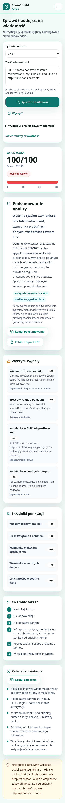

# ScamShield Senior

ScamShield Senior is an educational assistant for checking suspicious SMS messages, emails, and call descriptions. The analysis uses local rules in the browser; submitted text is not sent to an AI service or remote API.

## Run it locally

```bash
npm install
npm run dev
```

Open the local address printed by Next.js and choose **Analizuj** or open `/analyze`. Paste a message, select its type, and run the check. The result explains matched signals and suggested next steps. You can also try a sample message and review saved results at `/history`.



This screenshot is captured from the production build in Chromium at 390 × 844.

## What the demo does

- Scores a message with a transparent, local rule set and explains the matched indicators.
- Stores up to 75 analysis results in browser `localStorage`. When storage is blocked or full, the result stays usable in the current tab and the page offers a retry.
- Registers a service worker in production. Navigation uses the network and falls back to a Polish offline page; the cache contains that fallback plus bounded Next.js static assets, never application HTML. Cache names follow the current app source, old versions are removed during activation, and the user sees a refresh prompt when an update takes control.
- Keeps the analyzer, result, sample messages, and history in Polish. Some secondary educational pages in the wider demo still contain English copy.

## Checks

```bash
npm run lint
npm run typecheck
npm run test:run
npm run build
```

The Vitest suite covers analysis, saved history normalization, and storage failures. Playwright also exercises analysis and history after a quota error, cache version cleanup, current online HTML, and the offline fallback.

```bash
python -m venv .venv-e2e
. .venv-e2e/bin/activate
python -m pip install -r e2e/requirements.txt
python -m playwright install chromium
PLAYWRIGHT_CHROMIUM_EXECUTABLE_PATH=/path/to/chromium python -m pytest -q e2e
```

## Limits

The score is a heuristic aid, not a probability or a guarantee of safety. The rule set has not been measured against a representative labeled Polish and English corpus. Do not paste passwords, full card numbers, PESEL, or banking credentials. Browser history is local and unencrypted; clear it on shared devices.
